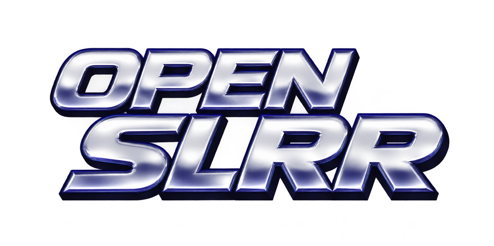
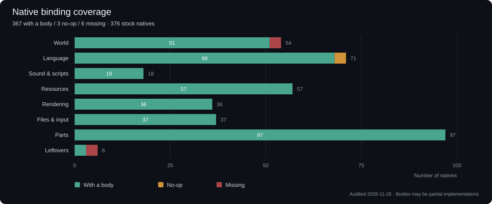

<p align="center">
  
</p>

<p align="center">
  <strong>Rebuild the engine. Return to the garage.</strong><br>
  A C++ reimplementation of the Street Legal Racing: Redline engine.
</p>

<p align="center">
  
  
  
  
</p>

<p align="center">
  <a href="https://eliasfd3s.github.io/openslrr/"><strong>Documentation</strong></a> · <a href="#progress">Progress</a> · <a href="#build">Build</a> · <a href="#run">Run</a> · <a href="#sources-and-credits">Sources and credits</a>
</p>

---
## Documentation

The modder documentation — natives, engine objects, and how to write a class, a scene, or an OSD — is published at **[eliasfd3s.github.io/openslrr](https://eliasfd3s.github.io/openslrr/)**.

Open SLRR brings the game's scripts, cars, and resources into a new engine. The project reimplements resource loading, script execution, rendering, the interface, and the native functions those scripts use.

**You can assemble a car in the garage and drive it on the Test Track.** The host runs the stock menus, catalog, showrooms and track selection. The Test Track has keyboard and SDL3 peripheral input, chase and cockpit cameras, vehicle instruments and a GPS map. The city, traffic and the full career loop are still in development.

Original game data is required and is not included. The reference version is **SLRR 2.2.1 MWM**; compatibility with other versions and mods is not guaranteed. This is an independent project, unaffiliated with the original game's developers or publishers.

For contributors and coding agents, [Engine contract and architecture](docs/core/ENGINE_CONTRACT.md)
documents the script/native compatibility contract, subsystem ownership, resource
IDs, coordinate systems, lifetime rules, Enhanced rendering and validation workflow.


## Progress

These milestones describe existing functionality, rather than a percentage of the game completed.

### Development videos

- [OpenSLRR DX11 x64 — Video 1](https://www.youtube.com/watch?v=g7GCU0DrdKI)
- [OpenSLRR DX11 x64 — Video 2](https://www.youtube.com/watch?v=4pkLV2srGMs)

### Native bindings



<!-- native-coverage:start (generated by scripts/render_native_coverage.py) -->
**370 with a body · 3 explicit no-ops · 3 missing**, out of **376 stock natives** (26 November 2026).
The bars show **numbers of functions**, not percentages. A body can still be partial or return a fixed value; these counts do not establish full behavior or validation in game. The separately counted no-op functions are explicitly registered as `native_noop`.

| Family | With a body | No-op | Missing |
| --- | ---: | ---: | ---: |
| World | 54 | 0 | 0 |
| Language | 68 | 3 | 0 |
| Sound & scripts | 18 | 0 | 0 |
| Resources | 57 | 0 | 0 |
| Rendering | 36 | 0 | 0 |
| Files & input | 37 | 0 | 0 |
| Parts | 97 | 0 | 0 |
| Leftovers | 3 | 0 | 3 |
| **Total** | **370** | **3** | **3** |
<!-- native-coverage:end -->

World covers GroundRef, particles, animation and PhysicsRef; language covers `java.lang`. Resources covers GameRef, ResourceRef, RenderRef and SfxRef; rendering covers GfxEngine, Text, Camera and Viewport. Files & input includes File, FindFile, Input, Controller and MouseCursor; parts includes Part, Chassis, WheelRef, DynoData and SfxTable. Sound & scripts covers Sound, Vehicle, Painter, Navigator and GameLogic. Leftovers groups the three networking compatibility calls and the unused Welder API; it does not establish their historical origin.

The chart, the counts above and [native-coverage.json](assets/progress/native-coverage.json) are generated from the source tree: `scripts/render_native_coverage.py` matches the pinned stock table in [stock-natives.json](assets/progress/stock-natives.json) against the class, method and full descriptors (including return types) passed to `register_method` under `src/`. Only the omitted-void alias is accepted; mismatched returns and slash-form descriptors fail the audit. After binding, removing or moving natives, run `python scripts/render_native_coverage.py` (standard library only) and commit the regenerated files; `--check` reports stale outputs or descriptor errors and `--list missing` prints the remaining signatures. See the [native audit and roadmap](docs/scripting/natives.md) for the explicit no-ops, known mocks and behavioral gaps.

### Features

| Area | Current state |
| --- | --- |
| Scripts | ✅ TUFA classes and TREE programs, inheritance, Java and native calls; embedded C++ compileAll supports multiple classes per source container. See [scripting/compiler.md](docs/scripting/compiler.md) |
| Script scheduling | ✅ Cooperative Windows fiber stacks; real run/sleep/wait, isAlive, stop, suspend/resume, and frame budgets. GameType callback lists and notification routing. See [scripting/runtime.md](docs/scripting/runtime.md) |
| VM memory | ✅ Mark/sweep garbage collection, pin/unpin and finalizers; conservative native roots. See [scripting/vm-gc.md](docs/scripting/vm-gc.md) |
| Resources | ✅ RPK packs, SCX models, DDS mipmaps, PTX textures and CFG configurations. Packs, meshes, map objects and textures load on every CPU core |
| Rendering | ✅ bgfx/D3D11, skydomes, sun flares, environment reflections, car shadow maps and multilayer track materials |
| Interface | ✅ Menus, career dialogs, catalog, car showroom, track selection, and paint inventory |
| Cars | ✅ Assembly from scripts and CFG files; reference Baiern with 76 parts. Showroom camera orbit, vehicle information, powertrain layout, gear ratios and dyno calculations |
| Workshop | ✅ Point at a part to read its name, hide the body or the engine, open panels with interpolated motion and adjust tunable parts. Remove or fit attached assemblies, and drag inventory parts onto Repair/Sell. Detached suspension parts regain their rest pose in the inventory |
| Physics | ⏳ Fixed-step chassis, suspension and tyre contacts, differential lock, impact deformation and panel detachment. Handling and damage still need comparison with the original |
| Audio and video | ✅ Effects, loops, stock Cinepak FMV audio and four streamed music playlists mixed with SDL3_mixer. Repeated effects and menu sounds have separate overlap limits |
| Options | ✅ Game, Advanced Game and audio settings use `save/game/options`, writing JSON while still reading legacy SDAT saves. The patched OptionsDialog has a pedestrian density slider from 0.5 to 1.5 (an old saved value below 0.5 returns to 1.5), video presets and an advanced video page (#377). Traffic density is saved while its simulation is pending |
| Driving | ⏳ Test Track driving with engine SFX tables, keyboard and SDL3 peripherals, stock and CFG-defined instruments, and GPS. Acceleration has been compared with stock Nonus and Einvagen telemetry, with differences remaining |
| World and career | ⏳ City, traffic and complete career flow; vehicle purchase/save/load still need end-to-end validation |

Engine loops use the scripts' SFX tables. Music playlists currently play in sequential order. The [roadmap](docs/scripting/natives.md#roadmap) tracks the next steps for driving, collision and damage, navigation, garage actions and platform support.

### Recent changes

- Added GPS tile textures and markers, sun flares, DDS mipmaps and the Test Track's separate diffuse and decal UV channels. The Invictus Racing 500 logo appears on the circuit.
- Corrected the stock instrument panel's proportions and translucent background.
- Connected gameplay options to gearbox mode, steering help, ABS, launch ASR, units, damage and cockpit movement. The stock menu selectors and sliders save their values automatically.

- Implemented cooperative script threads and scoped GC roots for suspended stacks. Java message loops, the mechanic refresher and showroom camera can now run directly.
- Added GameType notification replacement/removal, event aliases/custom handlers/one-shot delivery, and control/drive/animate registrations.

- Added an engine-owned Config instance, audio sliders, and debounced option saving, with a final save on normal shutdown.
- Effects, streamed music and stock Cinepak FMV are mixed by SDL3_mixer (#385, replacing FMOD), preserving separate volumes, bounded effects and playlist recovery. No proprietary audio SDK is needed to build. Optional VLC/Windows video-codec fallbacks keep their library-owned audio.
- Fixed `Input.createHotkey` being misrouted to Osd, slider track hit-testing, and tuning events carrying the actual slider to the part. Modal dialogs block clicks into the car behind them.
- Fixed reference casts used by tuning scripts, so mixture-ratio and similar assignments update the part instance.

Headless diagnostics cover all four music sets (muted), audio-volume save/reload and fuel-rail slider interaction through hit-testing and a modal wait. The latest tuning changes still need confirmation in normal gameplay. See [scripting/natives.md](docs/scripting/natives.md#rendering-sound-and-cursor-native-utilities) for implementation details and limits.

## Build

### Requirements

- **Windows x64** and **Visual Studio 2022**, with the **Desktop development with C++** workload and the Windows SDK.
- **CMake 3.21 or later** and **Git**, available in your terminal.
- An installation of **SLRR 2.2.1 MWM**, containing `system/Scripts/lang/System.class`.
- An Internet connection while preparing and initially configuring dependencies.

Open SLRR builds for Windows x64 with an MSVC-compatible compiler and uses bgfx for rendering. CMake rejects non-MSVC toolchains (including MinGW), x86 and ARM64 before adding targets. It loads the original game scripts and assets.

The original intros and the menu background are Cinepak AVI files with PCM sound, which Open SLRR decodes itself; 64-bit Windows has no Cinepak codec, and no VLC installation is needed. Other formats, such as H.264/AAC in MP4, need **VLC 3.x for Windows x64**. Open SLRR looks in the standard VideoLAN installation directory. For a custom installation, set `SLRR_VLC_DIR` to the absolute folder containing `libvlc.dll`, `libvlccore.dll`, and `plugins`.

### Quick start: build and run a branch

With the requirements above installed, clone this repository, then run in PowerShell:

```powershell
git clone https://github.com/EliasFD3S/openslrr.git
cd openslrr
powershell -NoProfile -ExecutionPolicy Bypass -File .\scripts\build-run-branch.ps1 -Branch main -GameRoot 'D:\Games\SLRR'
```

The execution-policy override applies only to that PowerShell process and must
be permitted by your organization. The helper prints the fetched branch commit
before building and the exact executable path/commit before launch; check those
messages to confirm which revision is running. Replace `main` with the desired branch and
the path with your SLRR 2.2.1 MWM installation. The helper fetches the latest branch tip on every run and checks it out in a separate checkout under
`%LOCALAPPDATA%\OpenSLRR-branch-builds`, builds Release, applies every payload
folder from that checkout's `patch/` to `GameRoot`, verifies copied file hashes,
and launches it. This installs the branch's compiled game scripts/UI and assets,
not just the engine. Top-level patch documentation is not copied. Existing files
are backed up before deployment under `<Workspace>/patch-backups/<unique-id>/`,
with a manifest recording the commit and newly added files. Backups must remain
outside `GameRoot` so old classes cannot shadow the new ones. A failed deployment
stops launch; it may leave a partially applied patch (use the backup to restore).
Files absent from the new patch are not removed automatically, so use a fresh
copy of the stock game when switching branches to avoid leftover branch files.
Do not run multiple helpers against the same game folder concurrently. Pass
`-Workspace 'D:\OpenSLRR-builds'` to change the checkout location.
`-ToolsCacheDir` enables the shared shader tool cache. Existing CMake cache
settings persist between runs. The helper uses the bgfx.cmake pin and build/launch
commands documented here; branches with different requirements may need a manual
build. Only build trusted branches and use a trusted workspace: CMake and the
resulting game execute code. The game can change saves and options in `GameRoot`;
use separate copies if running branches concurrently or to protect existing saves.

### Get the project

In PowerShell:

```powershell
git clone https://github.com/EliasFD3S/openslrr.git
cd openslrr

git clone https://github.com/bkaradzic/bgfx.cmake.git third_party/bgfx.cmake
git -C third_party/bgfx.cmake checkout 5ea74ee66662daef4089695846d6322da0dde94e
```

Run the following commands from this folder, which contains `CMakeLists.txt`.

### Configure and build

```powershell
cmake -S . -B build -G "Visual Studio 17 2022" -A x64

cmake --build build --config Release --target slrr_host --parallel
```

CMake downloads the hash-pinned SDL 3.4.20 and SDL3_mixer 3.2.4 sources and builds them statically (peripherals, audio output, WAV and MP3 decoding); no SDL DLL is needed. Offline builds can supply `-DFETCHCONTENT_SOURCE_DIR_SDL3=<SDL source directory>` and `-DFETCHCONTENT_SOURCE_DIR_SDL3_MIXER=<SDL_mixer source directory>`.

The executable is generated at `build/Release/slrr_host.exe`. The first build includes bgfx and its shader tools, so it may take a while.

Audio regressions (muted, through the real SDL audio device):

```powershell
cmake -S . -B build -DBUILD_TESTING=ON
cmake --build build --config Release --target audio_recovery --parallel
ctest --test-dir build -C Release --output-on-failure
# Optional: also start all four playlists from a private game copy.
.\build\Release\audio_recovery.exe --root data\game
# Cinepak PCM, clock fallback, looping and video cancellation regressions.
powershell -File scripts/run_save_io_tests.ps1 -Suite video_safety
```

#### Faster builds

- Every target compiles its files in parallel (`/MP`). Set `-DSLRR_COMPILE_JOBS=<n>` to cap the `cl.exe` processes per project; the default uses all logical processors. `slrr_host` also precompiles the standard headers most sources include.
- The shader compiler `shaderc` (with glslang, SPIRV-Tools and Tint) is most of bgfx's build time and is the same for every checkout. To build it once and reuse it from any number of checkouts or worktrees, set `-DSLRR_TOOLS_CACHE_DIR=<dir>` or the environment variable of that name. The first build fills `<dir>/shaderc-<key>` under a lock while other builds wait; the key covers the revisions and uncommitted changes of bgfx.cmake, bgfx, bimg and bx and the compiler, so a changed pin, edit or toolchain builds a new copy. Leave it unset to build `shaderc` inside the build directory. See [AGENTS.md](AGENTS.md#build-speed-and-its-edge-cases) for edge cases.

Dependency locations follow the paths selected by the pinned `bgfx.cmake`:
its in-tree `bgfx`/`bimg`/`bx` checkouts, explicit `BGFX_DIR`/`BIMG_DIR`/`BX_DIR`,
or FetchContent. A custom `FETCHCONTENT_BASE_DIR` is supported; the host uses
the same sources for ImGui, shader includes and bimg headers as the libraries.
For pre-existing source checkouts, pass absolute paths with
`-DFETCHCONTENT_SOURCE_DIR_BGFX=...`, `-DFETCHCONTENT_SOURCE_DIR_BIMG=...` and
`-DFETCHCONTENT_SOURCE_DIR_BX=...`. Keep their revisions aligned with the pinned
wrapper. `FETCHCONTENT_FULLY_DISCONNECTED=ON` requires sources already present;
it does not download a missing dependency.


## Run

```powershell
# Intros, then menus. This workspace keeps the install in data/game.
.\build\Release\slrr_host.exe --game --root data\game --window

# Baiern assembled from its scripts and configurations.
.\build\Release\slrr_host.exe --game --spawn-car cars/racers/Baiern.rpk:0x6 --root data\game --window
```

Press **Ctrl+F12** in any game section to toggle the ImGui debug panel.

To measure frame time on a repeatable Valo City drive (the same street, frame by frame, for every build):

```powershell
.\build\Release\slrr_host.exe --game --window --root data\game --no-vsync `
  --spawn-car cars/racers/Baiern.rpk:0x6 --bench-map ValoCity --bench-drive 40 --bench-time 13 `
  --perf-log city.csv
```

That straight run leaves the road after about 12 s. For measurements, replay a
recorded drive instead: play normally with `--record-path drive.path`, then
run the benchmark with `--replay-path drive.path` (no `--bench-drive`; the
drive lasts the recording). `scripts/perf_baseline.ps1 -SourceRoot game -Out
DIR -ReplayPath assets\validation\perf-baseline\drive.path` replays the
reference drive by day and night, on all cores, four P-cores and four
E-cores, with the saved settings and a low preset, and writes a summary.
`--seed N` fixes the script random numbers.

For career-only performance issues, use `--bench-career save/carrer/NAME`
instead of `--spawn-car`, with `--bench-map ValoCity`. This invokes the original
career loader; use a copied game/save root for repeatable measurements because
normal career working files and options can be written. `--bench-realtime` keeps
wall-clock frame deltas, including stalls/catch-up, rather than the default
fixed 1/60 s simulation benchmark. Its two-second warm-up and drive duration are
wall-clock durations. `--bench-traffic 0..1` sets the city traffic density for
the run (the perf roots have none); with 1, about 100 cars share the physics
thread.

`--renderer d3d11|d3d12|vulkan` runs the game on another bgfx backend (#186).
The default, `auto`, is Direct3D 11, the only backend validated in game;
Direct3D 12 and Vulkan exist to compare them, and Vulkan still fails one
ambient-occlusion regression. `scripts/perf_baseline.ps1 -Renderers
d3d11,d3d12,vulkan` adds them to the benchmark matrix. On a machine with two
GPUs, set `SLRR_GPU_VENDOR=nvidia` (or `amd`, `intel`) so every backend uses
the same adapter. Results and open points are in
[rendering/backend.md](docs/rendering/backend.md#bgfx-backend-selection-and-the-vulkan-spike-186).

Opening the debug overlay starts frame timing automatically. The Renderer tab
shows CPU scripts, traffic, physics (with vehicle, pedestrian and collision
subtimes), collection, shadows, reflections, presentation wait and GC. Physics
and flush totals include their subtimes; do not sum every displayed row.
Physics steps on its own thread while the frame is drawn: the physics total is
the host's share (preparing the batch, waiting for it, publishing it), and the
vehicle time is the physics thread's batch, not part of that total. Add
`--physics-inline` to step physics on the host thread instead, for debugging or
comparison; from the same starting state the fixed-step drive gives the same
car states either way. Values
are from the last completed measurement window, alongside bgfx's delayed render
and GPU counters. A large GPU reading alone does not identify the whole frame's
bottleneck.

The Renderer tab is organised in sections. **Timings** lists the GPU time of
every bgfx view (sun cascades, lamp and car lamp shadow tiles, AO passes,
reflection faces, world, OSD), sorted by cost, with a 120-frame average,
minimum and maximum, the CPU time of renderer phases (collection, prop
batches, lamp selection, sun/vehicle/lamp shadows, fixture shadows, AO,
reflections, submission), draws, primitives, instances, batches, texture and
render-target memory; **Freeze**, **Copy to clipboard** and **Log** take a
snapshot. **Log** also appends it to `perf/renderer_debug_YYYYMMDD_HHMMSS.txt`
next to `slrr_host.exe` (for example `build/Release/perf/`); the menu shows
the path. **Passes** and **Budgets and quality** are debug overrides that are
not saved: AO, each sun cascade, shadow caching, vehicle and character
casters, garage fixture shadows, street lamp lighting and shadows, car lamp
tiles, reflections, sky, clouds, fog, MSAA, anisotropic filtering, map props,
vehicles, characters and the OSD; lamp count and distance, shadowed lamps, car
lamp tiles, shadow tile sizes, cascade radius scale, AO resolution,
reflection faces per frame, map prop LOD bias, forcing the highest prop LOD,
and the far size cull (4 px by default). **Buffers** shows the lamp/fixture shadow atlas,
the sun cascade atlas and the AO buffer. **Options (saved)** holds the saved
Enhanced graphics options as before.

`--perf-log` prints one `[perf]` line per simulated second and writes the same fields to the CSV file. Add `--bench-shots DIR` to capture the window every 10 seconds. The run writes `save/game/options` on exit like a normal session.
The CSV's `interpolation_ms` field measures render-pose publication inside Physics, not downstream pose readers or scene-cache work. Do not add it to the inclusive Physics total.
During the drive, a `[bench] t=… speed=… rpm=… gear=…` line every 0.1 s of simulated time gives a speed trace at the interval of the original-game telemetry. On a map without ground props, such as the drag strip (`--bench-map Drag_Track`, about 12 s of straight road), the drive starts once the car has rested on all its wheels for 5 s.

Select a visible vehicle or a preview in **Vehicle**, or use **Freeze
telemetry** to hold a sample. **Tuning** changes tyre parameters and
simulation speed live. **Renderer** has visual toggles. **Section** shows
VM statistics and lets you opt into editing numeric fields of the active
script object. **OSD** and **Input** show interface and controller state.
Debug tuning and render settings last for the current session.

Use **Game Options** for transmission, distance units, GPS mode, damage difficulty and driver assists. **Advanced Game Options** adjusts cockpit motion from steering, speed and acceleration. **Sound Options** controls the three audio volumes. The game restores these values from `save/game/options` at startup.

In the garage, **right-click and drag**, the **arrow keys**, and the **scroll wheel** control the camera. From the garage, enter the **Test Track** to drive with your keyboard or SDL3 peripherals. Connect wheels, separate pedals and shifters before opening the control options, then bind each device's axes/buttons there. Reopen the options after adding a new device. The primary gamepad retains the existing default driving controls and saved `XInput Gamepad` profile name; it is now polled through SDL3. **Escape** skips the intros.

You can also set the game path with `$env:SLRR_GAME_ROOT`. The `--root` option takes priority. Without either, the host looks for `data/game`, then `game` and `../game`. Run `slrr_host.exe --help` for all options.

Cars out in the world drive through a gusty wind: by default a 4 m/s breeze, as a weather report measures it at 10 m height, blowing towards 60° from +Z towards +X. `--wind M/S[,HEADING]` changes it, and `--wind 0` gives calm air, for example to compare bench runs.

### Outline fonts

The text renderer prefers `frontend/fonts/<stem>.ttf`, then `.otf`, in the game
root. Bake the nine stock text fonts from your own installation once (Python
3.10+; these packages are conversion tools, not engine/build dependencies):

```powershell
py -m pip install Pillow fonttools
py scripts/bake_slrr_fonts.py --root data/game
```

The converter traces the white glyph fill at quarter-pixel coverage resolution,
strips baked black effects, and preserves the SCX byte mapping, advances and bearings. It produces real TrueType
outlines, not embedded bitmap strikes. It does not recreate the original design
curves: contours are traced from the available pixels. Generated fonts remain in
your game copy; original game assets are not distributed in this repository.
Missing/invalid outline fonts fall back to the stock SCX/atlas path, so existing
installs and mods still work. Symbol-pointer icons and vehicle-instrument atlases
keep their authored bitmap resources. Restart after replacing a font.

TTF (TrueType outlines) and OTF (CFF outlines) share one SDF text shader with
independent outline and drop-shadow colours/options. Stock SL/SLII fonts default to
a black outline and shadow; other fonts default to plain fill. Engine callers
can override a line with `slrr_text_set_effects`: outline width 0–2 pixels, shadow
X/Y offsets −3–3 pixels, and ARGB effect colours (alpha zero disables an effect).
These are engine-side text options, not new Java natives or saved game settings.
Legacy bitmap fonts keep their authored effects. Text remains byte-indexed,
without Unicode shaping or kerning. Replacement fonts are trusted local assets;
the bundled stb font parser is not a sandbox for untrusted font files.

Font regressions, after baking and building:

```powershell
py tests/test_bake_slrr_fonts.py
py tests/test_bake_slrr_fonts.py --write-otf build/font-fixtures/test.otf
powershell -File scripts/run_save_io_tests.ps1 -Suite outline_font
powershell -File scripts/run_save_io_tests.ps1 -Suite osd_text_batch
```

## Sources and credits

The project draws on community research to understand SLRR's formats and behavior. Your installation's scripts and resources supply the classes, parts, and their parameters; the C++ engine reimplements the functions they expect.

| Source | Contribution |
| --- | --- |
| [SLRR-JVM-decompiler](https://github.com/nedobylskiy/SLRR-JVM-decompiler) | TUFA class format and script instructions |
| [SLRR-JVM-compiler](https://github.com/nedobylskiy/SLRR-JVM-compiler) | Writing and regenerating TUFA classes |
| [SLRR-JVM](https://github.com/nedobylskiy/SLRR-JVM) | Reference for the scripting language and native functions |
| [SLRR_rev](https://github.com/nedobylskiy/SLRR_rev) | RPK/SCX formats, configurations, materials, and physics research |
| [slrr-reverse](https://github.com/EliasFD3S/slrr-reverse) | Additional reference for native contracts, engine behavior and suspension/link research |
| [io_invo_scx](https://github.com/nonamesex/io_invo_scx) | SCX mesh structure |
| [bgfx](https://github.com/bkaradzic/bgfx) and [bgfx.cmake](https://github.com/bkaradzic/bgfx.cmake) | Graphics rendering and CMake build integration |
| [SDL3](https://github.com/libsdl-org/SDL) | Gamepad and multi-peripheral joystick input |

Physics research is being integrated gradually: listing a reference does not mean the entire original simulation has already been reproduced. Thanks to the authors of these tools and research, and to the original game's creators.

## Contributing

When reporting a problem, include your game version, launch command, expected behavior, and actual result. Attach console output and, if useful, a screenshot. If you use a mod, name it and check whether the issue also occurs with the reference game data.

To explore the code: `src/jvm/` runs scripts, `src/resources/` loads data, `src/natives/` connects scripts to the engine, and `src/render/`, `src/ui/`, `src/platform/`, and `src/physics/` contain the main systems.

## License

OpenSLRR's original code is licensed under the [MIT License](LICENSE).
Third-party components retain their respective licenses and copyright notices,
including the vendored [SLRR script compiler](third_party/slrrc/LICENSE).
Original SLRR game assets and scripts are not covered by this license.
