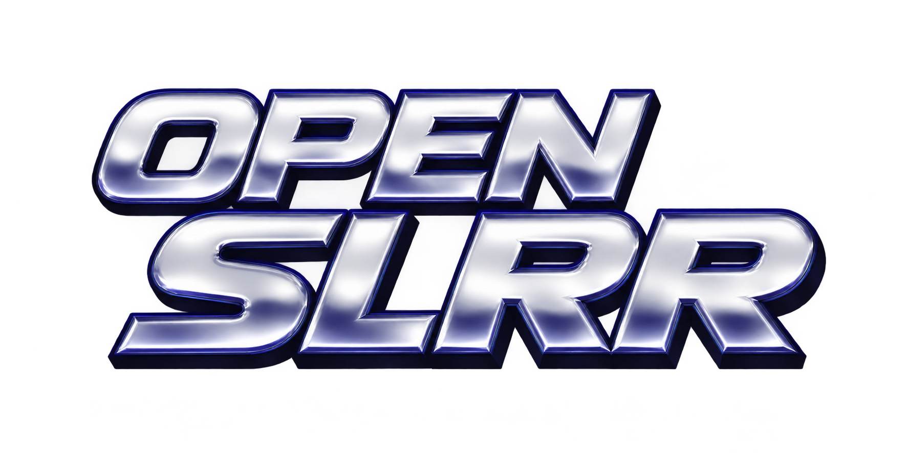
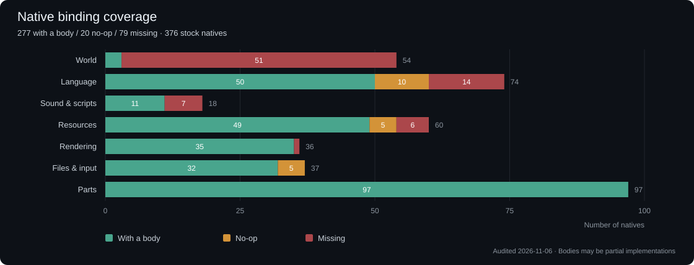

<p align="center">
  
</p>

<p align="center">
  <strong>Rebuild the engine. Return to the garage.</strong><br>
  A C++ reimplementation of the Street Legal Racing: Redline engine.
</p>

<p align="center">
  
  
  
  
</p>

<p align="center">
  <a href="#progress">Progress</a> · <a href="#build">Build</a> · <a href="#run">Run</a> · <a href="#sources-and-credits">Sources and credits</a>
</p>

---

Open SLRR brings the game's scripts, cars, and resources into a new engine. The project reimplements resource loading, script execution, rendering, the interface, and the native functions those scripts use.

**You can assemble a car in the garage and drive it on the Test Track.** The host runs the stock menus, catalog, showrooms and track selection. The Test Track has keyboard and XInput driving, chase and cockpit cameras, vehicle instruments and a GPS map. The city, traffic and the full career loop are still in development.

Original game data is required and is not included. The reference version is **SLRR 2.2.1 MWM**; compatibility with other versions and mods is not guaranteed. This is an independent project, unaffiliated with the original game's developers or publishers.


## Progress

These milestones describe existing functionality, rather than a percentage of the game completed.

### Native bindings



**307 with a body · 6 explicit no-ops · 63 missing**, out of **376 stock natives** (9 November 2026).
The bars show **numbers of functions**, not percentages. A body can still be partial or return a fixed value; these counts do not establish full behavior or validation in game. The separately counted no-op functions are explicitly registered as `native_noop`.

| Family | With a body | No-op | Missing |
| --- | ---: | ---: | ---: |
| World | 4 | 0 | 50 |
| Language | 69 | 4 | 1 |
| Sound & scripts | 13 | 0 | 5 |
| Resources | 52 | 2 | 6 |
| Rendering | 35 | 0 | 1 |
| Files & input | 37 | 0 | 0 |
| Parts | 97 | 0 | 0 |
| **Total** | **307** | **6** | **63** |

World covers GroundRef, particles, animation and PhysicsRef; language covers `java.lang`. Resources covers GameRef, ResourceRef, RenderRef and SfxRef; rendering covers GfxEngine, Text, Camera and Viewport. Files & input includes File, FindFile, Input, Controller and MouseCursor; parts includes Part, Chassis, WheelRef, DynoData and SfxTable. Sound & scripts covers Sound, Vehicle, Painter, Navigator and GameLogic.

The snapshot matches the stock native table against registered class, method and parameter signatures. See the [native audit and roadmap](NATIVE_AUDIT.md) for the explicit no-ops, known mocks and missing signatures. Counts are stored in [native-coverage.json](assets/progress/native-coverage.json). After auditing a new snapshot, regenerate the graphic with `python tools/render-native-coverage.py` (standard library only).

### Features

| Area | Current state |
| --- | --- |
| Scripts | ✅ TUFA classes and TREE programs, inheritance, Java and native calls |
| Script scheduling | ✅ Cooperative Windows fiber stacks; real run/sleep/wait, isAlive, stop, suspend/resume, and frame budgets. GameType callback lists and notification routing. See [SCRIPT_RUNTIME.md](SCRIPT_RUNTIME.md) |
| VM memory | ✅ Mark/sweep garbage collection, pin/unpin and finalizers; conservative native roots. See [VM_GC.md](VM_GC.md) |
| Resources | ✅ RPK packs, SCX models, DDS mipmaps, PTX textures and CFG configurations |
| Rendering | ✅ bgfx/D3D11, skydomes, sun flares, environment reflections, projected car shadows and multilayer track materials |
| Interface | ✅ Menus, career dialogs, catalog, car showroom, track selection, and paint inventory |
| Cars | ✅ Assembly from scripts and CFG files; reference Baiern with 76 parts. Showroom camera orbit, vehicle information, powertrain layout, gear ratios and dyno calculations |
| Workshop | ✅ Point at a part to read its name, hide the body or the engine, open panels with interpolated motion and adjust tunable parts. Remove or fit attached assemblies, and drag inventory parts onto Repair/Sell. Detached suspension parts regain their rest pose in the inventory |
| Physics | ⏳ Fixed-step chassis, suspension and tyre contacts, differential lock, impact deformation and panel detachment. Handling and damage still need comparison with the original |
| Audio and video | ✅ Effects, loops, FMV audio and four music playlists streamed with Media Foundation/XAudio2. Repeated effects and menu sounds have separate overlap limits |
| Options | ✅ Game, Advanced Game and audio settings use the stock `save/game/options` format. Traffic and pedestrian density values are saved while their simulation is pending |
| Driving | ⏳ Test Track driving with engine SFX tables, keyboard and XInput, stock and CFG-defined instruments, and GPS. Acceleration has been compared with stock Nonus and Einvagen telemetry, with differences remaining |
| World and career | ⏳ City, traffic and complete career flow; vehicle purchase/save/load still need end-to-end validation |

Engine loops use the scripts' SFX tables. Music playlists currently play in sequential order. The [roadmap](NATIVE_AUDIT.md#roadmap) tracks the next steps for driving, collision and damage, navigation, garage actions and platform support.

### Recent changes

- Added GPS tile textures and markers, sun flares, DDS mipmaps and the Test Track's separate diffuse and decal UV channels. The Invictus Racing 500 logo appears on the circuit.
- Corrected the stock instrument panel's proportions and translucent background.
- Connected gameplay options to gearbox mode, steering help, ABS, launch ASR, units, damage and cockpit movement. The stock menu selectors and sliders save their values automatically.

- Implemented cooperative script threads and scoped GC roots for suspended stacks. Java message loops, the mechanic refresher and showroom camera can now run directly.
- Added GameType notification replacement/removal, event aliases/custom handlers/one-shot delivery, and control/drive/animate registrations.

- Added an engine-owned Config instance, audio sliders, and debounced option saving, with a final save on normal shutdown.
- Replaced the failing MCI music player with bounded PCM streaming through Media Foundation and XAudio2. Music volume is independent of effects and FMV.
- Fixed `Input.createHotkey` being misrouted to Osd, slider track hit-testing, and tuning events carrying the actual slider to the part. Modal dialogs block clicks into the car behind them.
- Fixed reference casts used by tuning scripts, so mixture-ratio and similar assignments update the part instance.

Headless diagnostics cover all four music sets (muted), audio-volume save/reload and fuel-rail slider interaction through hit-testing and a modal wait. The latest tuning changes still need confirmation in normal gameplay. See [HOST_NATIVE_UTILITIES.md](HOST_NATIVE_UTILITIES.md) for implementation details and limits.

## Build

### Requirements

- **Windows x64** and **Visual Studio 2022**, with the **Desktop development with C++** workload and the Windows SDK.
- **CMake 3.21 or later** and **Git**, available in your terminal.
- An installation of **SLRR 2.2.1 MWM**, containing `system/Scripts/lang/System.class`.
- Windows Media Foundation for music decoding (included in standard Windows installations; Windows N editions need the Media Feature Pack).
- An Internet connection while preparing and initially configuring dependencies.

Open SLRR builds for Windows x64 and uses bgfx for rendering. It loads the original game scripts and assets.

Install **VLC 3.x for Windows x64** for the original Cinepak AVI intros, the menu background, and formats such as H.264/AAC in MP4. Open SLRR looks in the standard VideoLAN installation directory. For a custom installation, set `SLRR_VLC_DIR` to the absolute folder containing `libvlc.dll`, `libvlccore.dll`, and `plugins`.

### Get the project

In PowerShell:

```powershell
git clone https://github.com/EliasFD3S/openslrr.git
cd openslrr

git clone https://github.com/bkaradzic/bgfx.cmake.git third_party/bgfx.cmake
git -C third_party/bgfx.cmake checkout 5ea74ee66662daef4089695846d6322da0dde94e
```

Run the following commands from this folder, which contains `CMakeLists.txt`. In the local development workspace, it is named `host/`.

### Configure and build

```powershell
cmake -S . -B build-bgfx-x64 -G "Visual Studio 17 2022" -A x64 -DSLRR_STAGE_BUILD=OFF

cmake --build build-bgfx-x64 --config Release --target slrr_host --parallel
```

The executable is generated at `build-bgfx-x64/Release/slrr_host.exe`. The first build includes bgfx and its shader tools, so it may take a while.

## Run

```powershell
# Intros, then menus.
.\build-bgfx-x64\Release\slrr_host.exe --game --root "D:\Games\SLRR"

# Baiern assembled from its scripts and configurations.
.\build-bgfx-x64\Release\slrr_host.exe --game --spawn-car cars/racers/Baiern.rpk:0x6 --root "D:\Games\SLRR"
```

Press **Ctrl+F12** in any game section to toggle the ImGui debug panel.
Select a visible vehicle or a preview in **Vehicle**, or use **Freeze
telemetry** to hold a sample. **Tuning** changes tyre parameters and
simulation speed live. **Renderer** has visual toggles. **Section** shows
VM statistics and lets you opt into editing numeric fields of the active
script object. **OSD** and **Input** show interface and controller state.
Debug tuning and render settings last for the current session.

Use **Game Options** for transmission, distance units, GPS mode, damage difficulty and driver assists. **Advanced Game Options** adjusts cockpit motion from steering, speed and acceleration. **Sound Options** controls the three audio volumes. The game restores these values from `save/game/options` at startup.

In the garage, **right-click and drag**, the **arrow keys**, and the **scroll wheel** control the camera. From the garage, enter the **Test Track** to drive with your keyboard or XInput profile. **Escape** skips the intros.

You can also set the game path with `$env:SLRR_GAME_ROOT`. The `--root` option takes priority; without either setting, the default folder is `../game`. Run `slrr_host.exe --help` for all options.

## Build and promote with a backup

```powershell
.\validate-and-promote.ps1
```

This compiles the x64 candidate, archives the sources and previous executable, then copies the new executable to `build-bgfx-x64/Release/`. Close the running Release executable before promotion.

## Sources and credits

The project draws on community research to understand SLRR's formats and behavior. Your installation's scripts and resources supply the classes, parts, and their parameters; the C++ engine reimplements the functions they expect.

| Source | Contribution |
| --- | --- |
| [SLRR-JVM-decompiler](https://github.com/nedobylskiy/SLRR-JVM-decompiler) | TUFA class format and script instructions |
| [SLRR-JVM-compiler](https://github.com/nedobylskiy/SLRR-JVM-compiler) | Writing and regenerating TUFA classes |
| [SLRR-JVM](https://github.com/nedobylskiy/SLRR-JVM) | Reference for the scripting language and native functions |
| [SLRR_rev](https://github.com/nedobylskiy/SLRR_rev) | RPK/SCX formats, configurations, materials, and physics research |
| [slrr-reverse](https://github.com/EliasFD3S/slrr-reverse) | Additional reference for native contracts, engine behavior and suspension/link research |
| [io_invo_scx](https://github.com/nonamesex/io_invo_scx) | SCX mesh structure |
| [bgfx](https://github.com/bkaradzic/bgfx) and [bgfx.cmake](https://github.com/bkaradzic/bgfx.cmake) | Graphics rendering and CMake build integration |

Physics research is being integrated gradually: listing a reference does not mean the entire original simulation has already been reproduced. Thanks to the authors of these tools and research, and to the original game's creators.

## Contributing

When reporting a problem, include your game version, launch command, expected behavior, and actual result. Attach console output and, if useful, a screenshot. If you use a mod, name it and check whether the issue also occurs with the reference game data.

To explore the code: `src/jvm/` runs scripts, `src/resources/` loads data, `src/natives/` connects scripts to the engine, and `src/render/`, `src/ui/`, `src/platform/`, and `src/physics/` contain the main systems.
