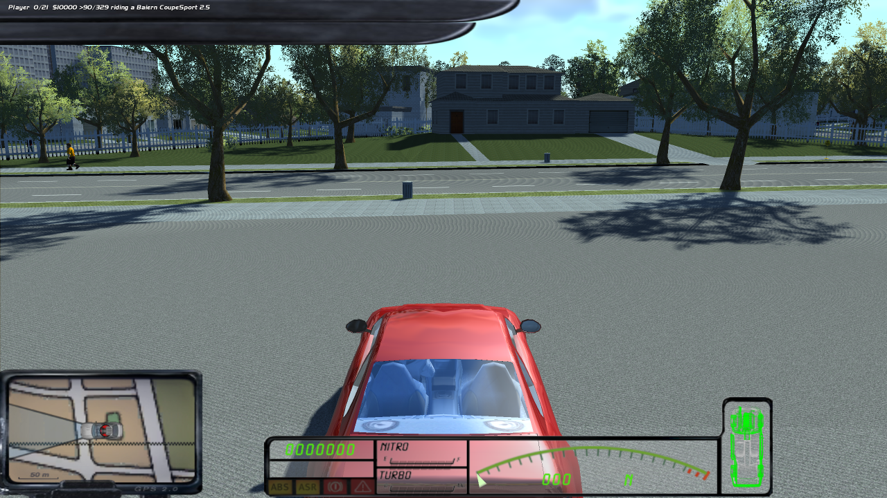
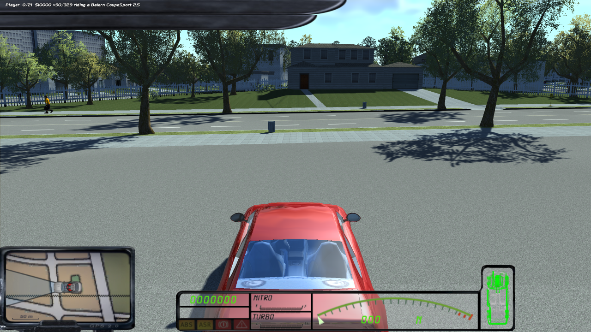

# Road banding and AO validation — 2026-11-20

## Diagnosis and scope

Matched isolated Valocity captures, 2560x1440 resized to 1280x720, Baiern stock,
14.9 h, HBAO high / strength 108 / radius 151 cm, high / Very Soft shadows.
AO-off still shows the large rings; map-shadow-off removes them. These are
outdoor shadow acne, not a sharpening pass or missing shadow draw distance.

## Fix

- Outdoor shadow taps use each texel's receiver-plane depth and a small physical
  residual bias. Relative gradient conditioning replaces the former absolute
  threshold; derivatives precede cascade selection. Fractional tents stay inside
  the atlas tile. Sharp/Soft/Very Soft use 4/16/16 comparisons per cascade, with
  the adjacent cascade sampled only within its blend band. The old path always
  sampled both cascades (1/9/9 hardware PCF fetches each). No FPS gain is claimed;
  per-quality cost still needs representative hardware validation.
- AO depth uses reversed-Z, clear 0, GREATER for ordinary/skinned/instanced
  draws, and matching reconstruction coefficients. GTAO ignores samples outside
  the receiver tangent hemisphere rather than letting quantised off-slice rays
  falsely darken a flat, distant road. Remove the 96-pixel AO radius cap so
  approaching a receiver no longer shrinks the requested radius in metres.
- No shadow-distance increase, global brightness compensation, or asset rewrite.

## Short timing check

Same isolated Valocity route/settings, three simulated seconds, two steady
60-frame report buckets after startup. Original shadow filter: average GPU
6.617 ms / frame 8.574 ms; corrected bounded filter plus world-space AO radius:
GPU 7.280 ms / frame 8.896 ms. This small local sample is not an FPS acceptance
matrix; the correction is not claimed to improve performance.

## Tests

Original outdoor shader fails the inclined self-receiver test: RGB sum 384
versus unobstructed 534. Corrected filters all give 534. Existing thin-caster,
radial transition/far fade, moving-sun lattice, atlas cache, real garage source,
alpha windows, emission, vertical-wall and reflection tests remain exercised.

Original GTAO distant plane: 1396 / 6640 pixels falsely darkened by >3/255.
Corrected HBAO low/medium/high: 0 / 0 / 37; GTAO: 0 / 0 / 10. Contacts still
occlude; instanced AO blocker produces 100 contact pixels. AO remains indirect
only and excluded from reflection/UI/preview views; resize/off cleanup tested.

Release and production D3D11 pixel regressions are checked separately from the
isolated game captures below. No temporal AO, generic GI, PBR, or full vendor
HBAO+/XeGTAO implementation is implied. Full hardware/per-quality performance
and every reported deformed-body reflection artifact remain outside this fix.

## Before

## After

