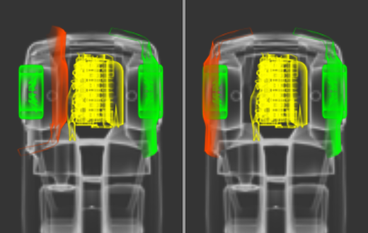

# Front-left damage HUD fender fix

## Cause and change

- The stock `cars/meshes/osdfont.scx` `q` UVs flip the longitudinal axis of
  the asymmetric fender tile instead of horizontally mirroring the right
  fender (`p`). Its bright outer edge therefore appeared beside the engine.
  For the exact stock damage resource and UV layout, the renderer now samples
  `p` with left/right corners exchanged, on `q`'s existing quad. It does not
  change the shared SCX or `LongOSDGauge.png`. Other glyphs are not reoriented.
- Previously, every category-2 body part could claim a fender if its mesh
  centre fell in that quad. For the stock font, only script `Quarterpanel`
  instances (including subclasses) now own `q/p/u/v`. Their own `wear * tear`
  supplies the condition. Accessories cannot color an installed fender or
  resurrect its indicator after removal. Side/front/rear comes from the
  closed/rest assembly pose, not damage or flap motion, and valid chassis
  bounds no longer change with panel removal. Other regions still use spatial
  aggregation; custom fonts retain their spatial region mapping.
- Semantic fender mapping is a host implementation, not recovered original
  native behavior. Non-Quarterpanel mod classes do not claim stock fender
  indicators simply because their meshes happen to be nearby.

## Visual check



**This is an asset-only software rendering, not an in-game screenshot.**
Both panels use the original atlas and SCX quad positions. Corrected UVs were
exported by calling the production `hud_stock_left_fender_uv` helper, then
bilinearly sampled for this comparison. Colors are fixed to make the orientation
visible: orange left fender, green wheels/right fender, yellow engine. This
shows the stripe move from the engine side to the outer fender. It does not
validate live impact damage or quarterpanel classification in gameplay.

## Validation, 20 November 2026

- Windows MSVC Release build of `slrr_host` and `vehicle_hud_damage`: passed.
- CTest `vehicle_hud_damage`: passed, 11 cases, including accessory isolation,
  absent fender, four independent panels, overlap with hood, independent engine
  and wheel damage, repair/removal refresh, horizontal UV mirror, shared-mesh
  immutability, custom font routing and custom UV preservation, invalid values.
- Optional integration check loads the user's unmodified stock SCX through
  `load_scx_geometry` and verifies the production UV repair recognizes it: passed.
- GCC C++20 strict-warning compilation and the initial 9-case suite: passed.
- Knowledge reference checker: 0 errors.
- **Not yet validated in live gameplay:** spawn different cars, damage one
  fender independently, remove/refit/repair it, and confirm no other part
  changes its indicator. The remaining non-fender regions still use the
  pre-existing spatial aggregation approximation.

## Reproduce

From the repository root in Windows PowerShell (use your existing build folder):

```powershell
cmake -S . -B build-bgfx-x64 -DBUILD_TESTING=ON
cmake --build build-bgfx-x64 --config Release --target slrr_host vehicle_hud_damage --parallel 4
ctest --test-dir build-bgfx-x64 -C Release -R '^vehicle_hud_damage$' --output-on-failure
.\build-bgfx-x64\Release\vehicle_hud_damage.exe C:\openslrr\open-SL\game\cars\meshes\osdfont.scx
```

The updated game executable is `build-bgfx-x64/Release/slrr_host.exe`. Run it
directly with `--game --root C:\openslrr\open-SL\game --window`; no Git pull or
branch switch is required to use this local fix.
