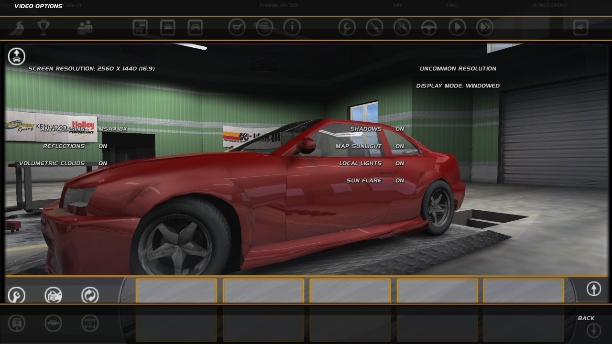
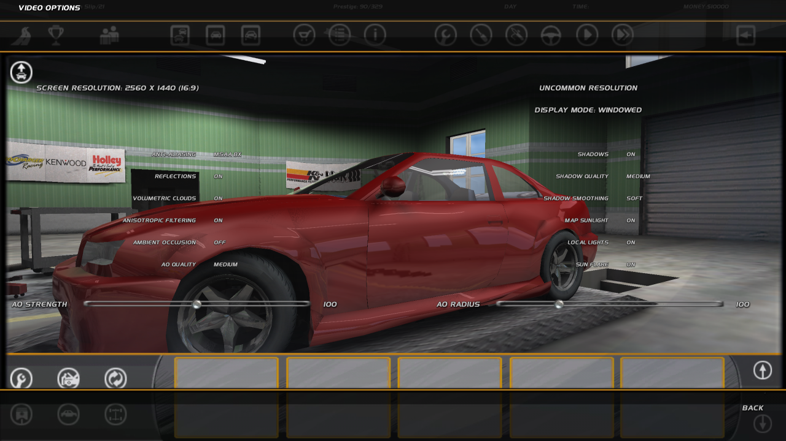

# Rendering Options comparison

Before: Video Options TUFA container from main 7f629d5.
After: source/compiled OptionsDialog from rendering branch 104d750.

Both captures use the same isolated game copy, fixed diagnostic executable,
resolution, camera and AO-off setting to compare only the menu layout. They are
not an FPS comparison or a before/after lighting baseline. No game-career data
or user graphics settings were changed.

The merged production Release was built separately and passed scene_shadow_gpu,
options_retry, render_programs_gpu, paint_texture (9 tests) and
vehicle_contacts_runtime (12 tests). Isolated Garage startup exits 0 / 3 frames.
Knowledge references: 350 checked, 120 external skipped, 0 errors.

Conflicts combined both scene includes (paint textures and neon adapter), both
sets of test suites and both documentation sections. Main's tracked compiler
source supersedes the old optional/missing-source local workaround. Those three
uncommitted files were preserved in git stash before the merge.

## Before

## After

