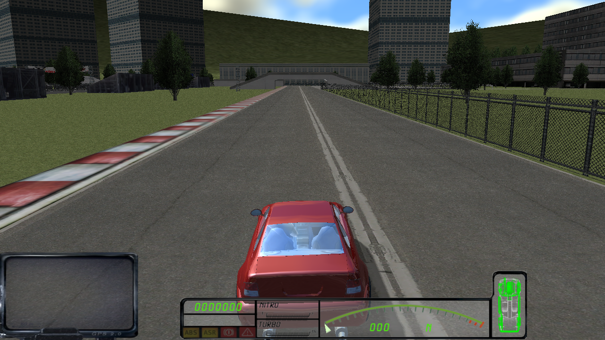
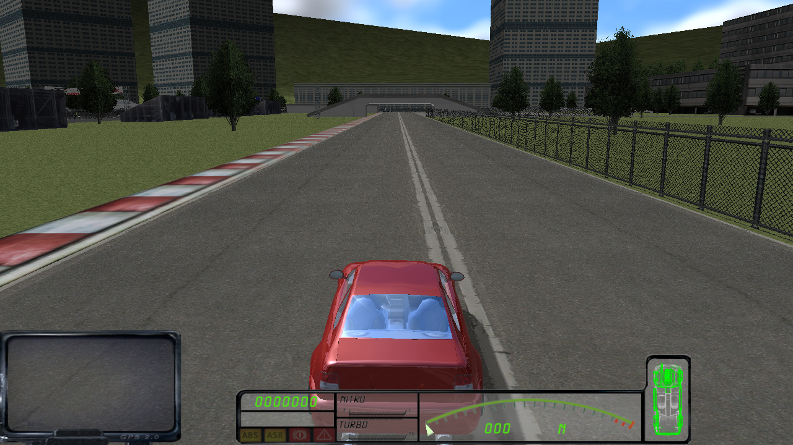
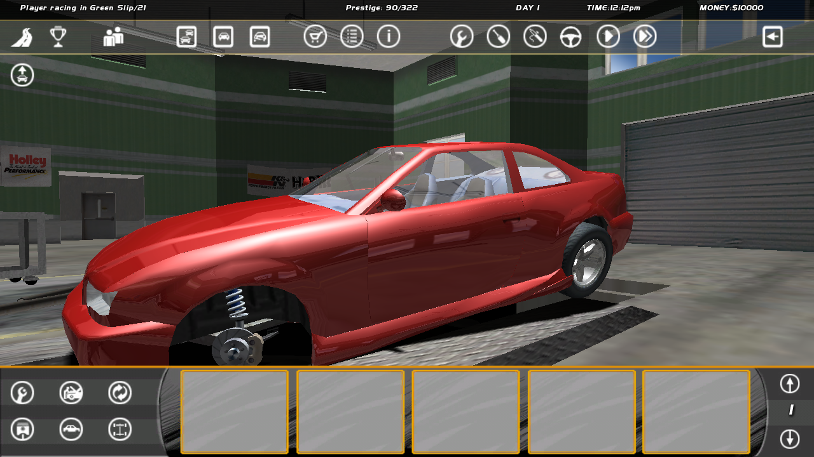
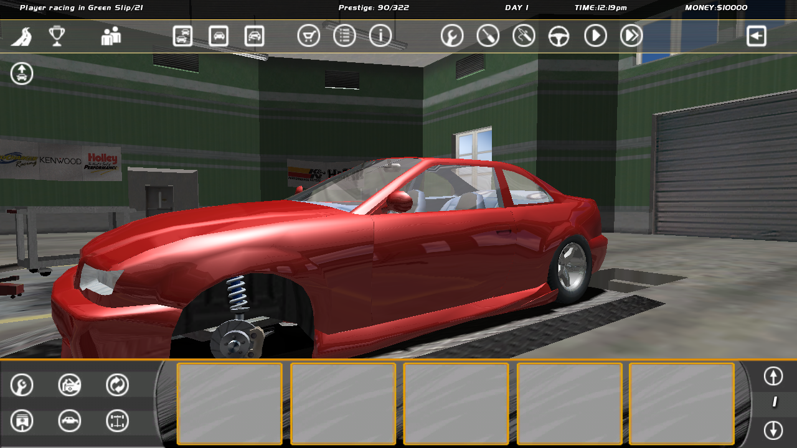

# Approved support migration — actual application evidence

**Before:** `8ac2ba9601300b36efca54dd81031fb6bc9de98b` (the intended tyre model).

**After:** `5570bf3` (stage A plus coherent support/static rest, including the render-to-part frame correction).

Both use Windows x64 MSVC Release, SLRR 2.2.1 MWM data, stock Baiern CoupeSport 2.5 (`cars/racers/Baiern.rpk:0x6`), 1280×720 and the normal game UI/camera mode. Bench physics advances at a fixed 1/60 s per host frame / 120 Hz solver. Time of day is set to 12:00 at the bench start. The game's displayed calendar clock continues on wall time, so its minute values differ in the long captures; the fixed-step bench/telemetry clock, not that UI clock, establishes the equal simulated duration. The camera follows the changed car pose; its resulting framing is part of the recorded outcome.

These are unedited application captures converted losslessly from renderer TGA output to PNG, not mockups. Temporary input/removal/telemetry hooks were used locally and are **not in the product changes**. They do not override forces or geometry. Removal at bench time 1 s destroys the selected installed part through the native lifecycle and refreshes the chassis; no loose removed object can strike the car. The garage case calls the existing `start` command to keep the body free-stepping, rather than allowing placement sleep to hide creep. This is a physics rest stress test, not a claim that the stock garage UI automatically releases its parked car.

## Missing rear-right spring

Drag_Track, neutral gear, throttle 0, service brake 1, steer 0, handbrake 0. The rear-right `Spring` is identified by its script `getWheel()` result and removed at 1 s. Captures are at bench time 10 s. All rims, tyres and the other three springs remain installed.

| Before | After |
| --- | --- |
|  |  |

During the final five seconds of the 12 s bench:

| Metric | Before | After |
| --- | ---: | ---: |
| World X displacement | −0.226 m | below 1 mm log precision |
| World Z displacement | −0.081 m | below 1 mm log precision |
| Peak logged lateral speed | 0.049 m/s | below 0.001 m/s |
| Final roll | +0.0328 rad (corner propped up) | −0.0172 rad (small spring-less sag) |

The runtime compression-stop fallback changes from CFG `base` (0.29 m for this car) to `base - travel` (0.19 m). The compliant support load is available to the tyre law in the same substep; brake-limited static friction then acts before pose advancement. The reference tyre curve is not reverted.

## Front-left rim removed: ten-minute garage rest

Garage, the front-left rim/tyre assembly removed at 1 s; remaining hub/disc hardware and the body can support the car. No throttle/steering input. Both runs use `--no-vsync` to advance the fixed-step bench faster. Each completed 620 simulated seconds (37,200 telemetry rows); captures below are at 600 s.

| Before | After |
| --- | --- |
|  |  |

| Metric, 10→600 simulated seconds | Before | After |
| --- | ---: | ---: |
| Net horizontal displacement | 0.607 m | no logged movement (1 mm per coordinate) |
| Vertical displacement | +0.1041 m | below 0.1 mm log precision |
| Final logged horizontal speed at 620 s | 1.344 km/h | below 0.004 km/h log precision |

This uses current-load metal/body contacts and bounded sticking impulses, not a new chassis sleep flag. Unsupported air and slopes beyond the friction cone still move in the focused regression suite.

## Verification and limits

- Clean, uninstrumented Windows x64 Release build at `5570bf3`: passes. Instrumented application replays are separate results, as described above.
- Linux standalone suites: vehicle dynamics 14/14, missing support 16/16, wheel mounts 7/7, flap hinges 12/12, mass properties 6/6 and dynamic response 2/2. Missing-support 16/16 also passes address/undefined-behaviour sanitizers. The added cases cover zero longitudinal grip, low-grip slope slip and independent force-ellipse axes.
- A Linux GCC comparison against the original tyre source gives bit-identical dynamic forces for 87,480 varied load/alignment/profile/slip combinations. The shared capacity helper changes static holding limits, not the intended Magic Formula. The grid digest and capture digests are in [the evidence metadata](evidence.json).
- The support suite includes eight body samples on a gentle slope, sliding beyond metal friction, weak brake budgets, mass scaling, no-ground air, native-traffic pull-away and real Baiern arm/hub geometry. The translated-map replay additionally checks the runtime render/part coordinate handoff.
- These runs do **not** validate the remaining gauge/loss policy, stronger permanent crush, engine fragmentation, or the complete driving matrix. Those approved stages remain open. Earlier rollover/tyre-swap/burnout images elsewhere in the parent directory remain historical evidence, not results for this revision.
